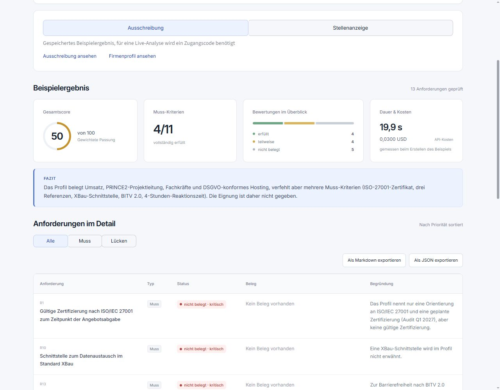
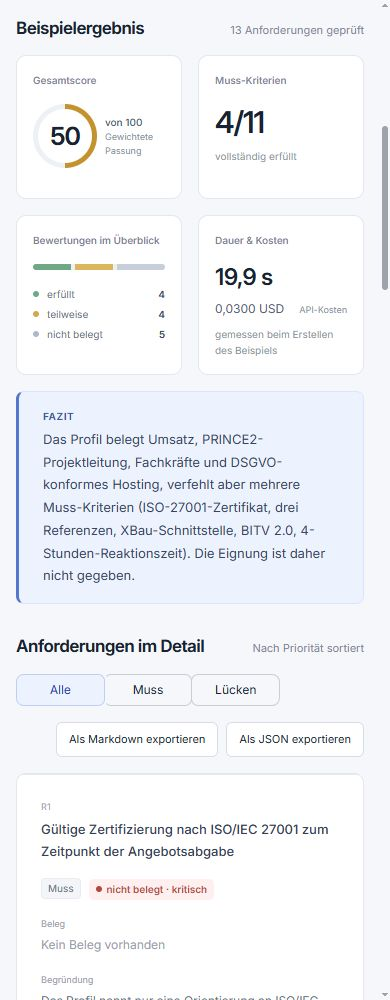
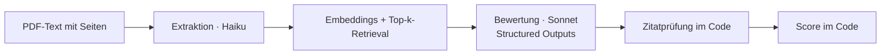

# Anforderungs-Check

Vergleicht eine Ausschreibung mit einem Firmenprofil oder eine Stellenanzeige mit einem Lebenslauf – Anforderung für Anforderung, mit wörtlichen Belegen und Seitenangaben.

**[Live-Demo öffnen](https://anforderungs-check.streamlit.app)** · Öffentlich sind gespeicherte, fiktive Beispiele verfügbar. Live-Analysen eigener oder ausgewählter Beispiel-PDFs benötigen einen Zugangscode.

<table>
  <tr>
    <td width="74%" valign="top"></td>
    <td width="26%" valign="top"></td>
  </tr>
</table>

## Problem

Anforderungen manuell gegen ein Profil zu prüfen ist langsam und fehleranfällig. LLMs allein können Belege erfinden. Die Demo verbindet deshalb semantisches Retrieval mit einer Zitatprüfung im Code: Jede positive Bewertung braucht einen auffindbaren Textausschnitt aus dem Profil.

## Ablauf und Architektur



**Python 3.11 · Streamlit · pypdf · sentence-transformers · NumPy · Anthropic SDK · Pydantic.** Beide PDFs werden direkt aus Bytes gelesen. Pro Analyse entsteht ein eigener NumPy-Index im Arbeitsspeicher. Das Embedding-Modell `paraphrase-multilingual-MiniLM-L12-v2` läuft auf der CPU und wird wiederverwendet. Pro Anforderung werden die fünf ähnlichsten Profil-Chunks abgerufen; doppelte Chunks gehen nur einmal an die Bewertung. Eine Vektordatenbank ist dafür nicht nötig.

`job` extrahiert Anforderungen an die Person, keine Stellenaufgaben. `tender` extrahiert Eignungs- und Leistungsanforderungen, keine Abgabefristen oder Angebotsformalien. Beide Modi teilen die Logik und unterscheiden sich in den Prompts. Standard: `claude-haiku-5-5` für Extraktion, `claude-sonnet-5-5` für Bewertung; überschreibbar über `MODEL_EXTRACT` und `MODEL_ASSESS`. Beide Stufen verwenden aus Pydantic abgeleitete JSON-Schemas und `effort="low"`.

## Entscheidungen mit Messwerten

**Structured Outputs:** In je fünf Haiku-Analysen sanken die Abbrüche von **3/5 auf 0/5**, Antwortkorrekturen von **4 auf 0**. Mittlere CLI-Dauer inklusive Modellladen: **24,14 → 18,84 Sekunden**. [Messbericht](docs/structured-outputs-vergleich.md)

**Haiku extrahiert, Sonnet bewertet:** Der frühere Vergleich mit gleichem Promptstand ergab:

| Bewertung | Läufe | Dauer je Analyse, Mittel | Kosten je Analyse, USD | Statuswechsel / vergleichbare Paare |
| --- | ---: | ---: | ---: | ---: |
| Haiku | 5 | 8,86 s | 0,0017313–0,0022217 | 4/52 |
| Sonnet | 2 | 11,30 s | 0,0247829–0,0302679 | 0/13 |

Das ist ein Hinweis auf konsistentere Sonnet-Bewertungen, kein allgemeiner Nachweis: kleine Stichprobe, damals zusätzlich wechselnde Anforderungslisten. Nach festen Modusregeln lieferten fünf Extraktionsläufe identische **13 Anforderungen**; drei vollständige Haiku/Sonnet-Analysen jeweils **Score 68, Muss erfüllt 6/7**, bei **10,11–11,43 s** und **0,0245084–0,0252384 USD** mit bereits geladenem Embedding-Modell. [Konsistenzvergleich](docs/konsistenz-vergleich.md) · [Extraktion und Kosten](docs/extraktion-kosten-vergleich.md)

**Zitatprüfung und deterministischer Score:** Belege müssen nach Normalisierung von Großschreibung, Leerraum und Zeilen-Silbentrennung auf einer Originalseite und in einem einzelnen Chunk vorkommen. Fehlende Zitate werden zu `nicht_belegt`, falsche Seitenangaben korrigiert. Das verifiziert die Textfundstelle, nicht die fachliche Schlussfolgerung. Der Code berechnet den Score: Muss zählt doppelt, Kann einfach; erfüllt = 1, teilweise = 0,5, nicht belegt = 0, normiert auf 0–100. Gleiche Bewertungen ergeben denselben Score.

**Gespeicherte Beispiele, Ergebnis und Messwerte jeweils aus demselben Lauf:**

| Beispiel | Score | Muss erfüllt | Dauer | API-Kosten, USD |
| --- | ---: | ---: | ---: | ---: |
| Ausschreibung | 50 | 4/11 | 19,906 s | 0,0299834 |
| Stellenanzeige | 68 | 6/7 | 24,292 s | 0,0247984 |

Die Zeiten enthalten gegebenenfalls die Modellinitialisierung, keine Python-Imports. Kosten beruhen auf API-Tokenwerten und den am **22.10.2026** hinterlegten Listenpreisen, ohne Steuern/Rabatte. Eine Prüfsumme verknüpft Ergebnis und Messwerte. [Beispiele und Messumfang](examples/README.md)

## Sicherheit und Betrieb

- Zugangscode aus `ACCESS_CODE`, Prüfung per `hmac.compare_digest`, Freigabe in der Sitzung. Ohne konfigurierte Variable keine Live-Analyse.
- **5 Analysen/Sitzung, 50/Tag, 2 gleichzeitig**, serverseitige Prüfung vor jedem API-Aufruf. Tageswechsel: Mitternacht in `Europe/Berlin`. Gemeinsame Zähler gelten pro Serverprozess; Neustarts setzen sie zurück.
- Keine dauerhafte Speicherung von Uploads; Dokumente und Profilindex bleiben im Arbeitsspeicher. Keine Dokumentinhalte oder Secrets in Logs. Für Live-Analysen werden Dokumenttexte an Anthropic übermittelt.
- Jede Anfrage bleibt samt Schema, Sicherheitsmarge und Antwortreserve unter **100.000 geschätzten Tokens**. **60 Sekunden** Timeout pro API-Aufruf, ein SDK-Retry und ein zusätzlicher Antwortkorrekturversuch.
- Streamlit Community Cloud, Deploy-Branch **`web-demo`**; Secrets ausschließlich aus Umgebungsvariablen.

## Grenzen

Pro PDF: **15 Seiten, 60.000 Zeichen, 5 MB Upload-Limit**. Nur PDFs mit ausreichender Textebene, keine OCR. Alle öffentlichen Beispiele sind fiktiv. Modellbewertungen können schwanken und brauchen fachliche Prüfung.

Lange Vergabeunterlagen würde ich abschnittsweise in Hintergrundjobs verarbeiten, mit zugriffsgeschütztem persistentem Index, hierarchischem Retrieval und Tokenbudgets pro Abschnitt; bei mehreren App-Prozessen müssten auch die Limits zentral verwaltet werden.

## Lokal starten

Windows CMD, Python 3.11, im Repository-Verzeichnis:

```cmd
py -3.11 -m venv venv
venv\Scripts\activate.bat
python -m pip install -r requirements.txt
streamlit run app.py
```

Ohne Zugangskonfiguration startet die öffentliche Beispielansicht. Für Live-Analysen vor dem Start `ANTHROPIC_API_KEY` und `ACCESS_CODE` in der Umgebung desselben CMD-Prozesses setzen und einen passenden Einladungslink verwenden. `.env.example` dokumentiert die Variablennamen; `.env` wird nicht automatisch geladen. Der erste Live-Start lädt das Embedding-Modell herunter. API-Aufrufe sind kostenpflichtig.

## Tests

**322 Tests ohne API-Aufrufe**, Netzwerkverbindungen sind gesperrt. Abgedeckt: Schema, Zitate, Seitenkorrektur, Score, Zugang, Limits und UI-Zustände. `pytest` nur lokal installieren:

```cmd
python -m pip install pytest
python -m pytest -q
```

## Projektstruktur

```text
app.py                         Streamlit-Oberfläche, Dashboard, Exporte
assets/                        CSS und lokale Schrift
copilot/pipeline.py            Ablauf, Zitatprüfung, Score
copilot/ingest.py, index.py     PDF-Text, Chunks, Embeddings, Retrieval
copilot/llm.py, schema.py       Prompts, Claude-Aufrufe, Pydantic-Modelle
copilot/access.py              Zugang und Limits
copilot/runtime_config.py      Timeouts und Ablaufzeit belegter Plätze
copilot/pricing.py, cli.py     Kosten und CLI für zwei PDFs
examples/                      Fiktive PDFs, Ergebnisse, Messwerte
docs/                          Messberichte und Screenshots
tests/                         Offline-Tests
```

---

Gebaut von [WxExLGHTZ](https://github.com/WxExLGHTZ).
